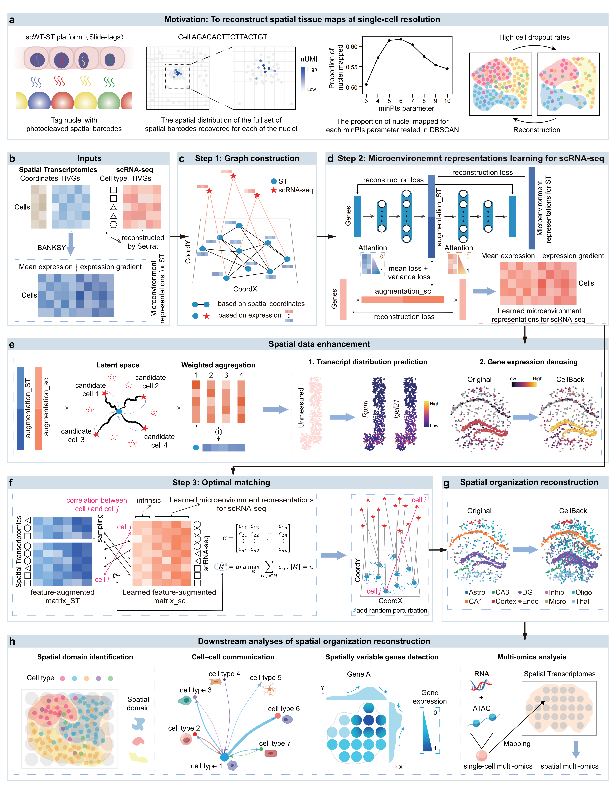

# CellBack: microenvironment-aware spatial organization reconstruction for spatial transcriptomics via globally optimal matching


Spatial transcriptomics (ST) enables gene expression profiling within intact tissues while preserving spatial context. However, recently developed **single-cell whole-transcriptome spatial transcriptomics (scWT-ST) platforms** (e.g. *Slide-tags*, *SeekSpace*) often suffer from **substantial cell loss**, resulting in incomplete tissue landscapes and compromised downstream analyses.
**CellBack** is a **microenvironment-aware spatial organization reconstruction framework** that reconstructs more complete spatial tissue maps at **single-cell resolution** by optimally mapping cells from matched scRNA-seq data into spatial contexts from a global perspective.  
By integrating **learned microenvironment representations** with a **globally optimal matching strategy**, CellBack faithfully recovers missing cells while preserving spatial tissue architectures.

In addition to cell imputation, CellBack:
- predicts transcript distributions for imaging-based ST platforms  
- denoises gene expression for sequencing-based ST platforms  
- enables spatial multi-omics integration at single-cell resolution  



---

## Key Features

- **Cell imputation for single-cell ST**  
  Recovers missing cells in Slide-tags, SeekSpace and similar platforms

- **Microenvironment-aware representations**  
  Integrates intrinsic gene expression with neighborhood context via BANKSY and graph neural networks

- **Globally optimal cell-to-space matching**  
  Avoids ambiguous one-to-one spatial predictions inherent to neural-network–based approaches

- **Broad downstream support**  
  Improves spatial clustering, cell–cell communication, and spatially variable gene detection

- **Spatial multi-omics integration**  
  Enables construction of spatial RNA–ATAC profiles at single-cell resolution

---

## Method Overview

CellBack consists of two major modules:

### 1. Microenvironment Representation Learning

- Harmonizes ST and scRNA-seq expression matrices.
- Generates microenvironment representations for ST cells using BANKSY.
- Constructs a cross-platform graph integrating:
  - spatial proximity (ST)
  - expression similarity (latent embeddings from scANVI)
- Applies a graph attention network to propagate microenvironment information
- Learns pseudo microenvironment representations for scRNA-seq cells

### 2. Optimal Matching–based Cell Imputation

- Maps scRNA-seq cells to missing spatial locations via globally optimal matching
- Preserves global tissue architecture and local microenvironment structure

---

## System Requirements

### OS requirements
CellBack is implemented in Python and can be run on both Linux and Windows.

Tested systems:
- Linux (recommended): Ubuntu 18.04 / 20.04 / 22.04, CentOS 7
- Windows: Windows 10 / 11

### Python requirements
Python **>= 3.8**

### Python dependencies

```txt
mudata==0.2.4
anndata==0.10.8
scanpy==1.10.2
igraph==0.11.6
leidenalg==0.10.2
scikit-learn==1.6.1
scikit-misc==0.3.1
```

## Installation Guide

### 1. Create a virtual environment (recommended)
We recommend using conda to manage dependencies by:

```bash
conda create -n cellback_env python=3.9
conda activate cellback_env
```
### 2. Install CellBack
Download the CellBack package from GitHub:
```bash
git clone https://github.com/jxLiu-bio/CellBack.git
cd CellBack
```
and install by:
```bash
pip install .
```

### 3. Install PyTorch and PyTorch Geometric
Install PyTorch according to your hardware configuration. For example, you can run:

```bash
pip install torch==2.1.0+cu121 torchvision==0.16.0+cu121 torchaudio==2.1.0+cu121   --index-url https://download.pytorch.org/whl/cu121
pip install torch_geometric
```
More information can be found at: [PyTorch](https://pytorch.org/get-started/locally/) and [PyTorch Geometric](https://pytorch-geometric.readthedocs.io/en/latest/notes/installation.html).


### 4. Install Seurat
Seurat is used to reconstruct a shared expression matrix between scRNA-seq and ST data,
which is subsequently used to derive the microenvironment matrix. You can install Seurat in the virtual environment by conda:
```bash
conda install -c bioconda r-seurat
```

### 5. Install scvi-tools
scANVI is employed to learn batch-corrected low-dimensional embeddings of cells,
which are subsequently used to construct the cell–cell adjacency graph for input into the graph attention network. Install scvi-tools in the virtual environment by pip:
```bash
pip install scvi-tools==1.15.0
```

## Tutorial
The detail step-by-step usage guide can be found in [Tutorial](https://cellback.readthedocs.io/en/latest/).
